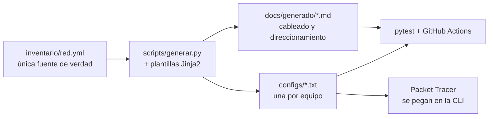

# NetCorp · Red empresarial multisede en Cisco

[](https://github.com/0scar07/netcorp-cisco/actions/workflows/validar.yml)


Diseño, implementación y validación de la red de **NetCorp**, una empresa ficticia con una sede central, dos sucursales y dos proveedores de Internet. Todo está montado en Cisco Packet Tracer y las configuraciones de los equipos **no se escriben a mano**: salen de un inventario en YAML, se generan con plantillas Jinja2 y se validan con pruebas automáticas en cada push.

> **Qué demuestra este proyecto:** diseño jerárquico de campus, alta disponibilidad en capa 2 y capa 3, enrutamiento interno y externo, VPN entre sedes, seguridad por capas y una forma de trabajar de "red como código" con control de versiones e integración continua.

---

## Topología


<details>
<summary>Versión en Mermaid (se puede editar como texto)</summary>


</details>

13 equipos de red, 6 servidores, 2 sitios remotos y 33 cables. El detalle puerto por puerto está en [docs/generado/cableado.md](docs/generado/cableado.md).

## Qué incluye

| Área | Tecnologías |
|------|-------------|
| **Conmutación** | VLANs por departamento, troncales 802.1Q con VLAN nativa sin uso, Rapid PVST+, EtherChannel LACP, VTP transparente |
| **Alta disponibilidad** | HSRPv2 con balanceo de carga entre los dos switches de distribución, raíz de STP alineada con el HSRP activo, doble router de borde, doble ISP y túneles de respaldo |
| **Enrutamiento interno** | OSPF multiárea (área 0 en la sede y los túneles, áreas 1 y 2 en las sucursales), resumen de rutas en los ABR, autenticación MD5 y `passive-interface` por defecto |
| **Enrutamiento externo** | eBGP con dos proveedores, publicación del bloque público propio y ruta por defecto principal y de respaldo inyectada en OSPF |
| **VPN** | GRE sobre IPsec (IKEv1, AES-256, SHA, DH grupo 5) en estrella con doble hub, para que OSPF viaje cifrado entre sedes |
| **Servicios** | NAT/PAT, NAT estática para publicar el servidor web, DHCP centralizado con relay y DHCP local en sucursales, DNS, NTP, Syslog, TFTP y SNMP |
| **Seguridad** | SSH v2 solo desde redes de gestión, AAA con TACACS+ y respaldo local, port-security, DHCP snooping, BPDU Guard, ACL para invitados y para la granja de servidores, puertos sin uso apagados |
| **Red como código** | Inventario YAML, plantillas Jinja2, generador en Python, 145 pruebas con pytest y CI en GitHub Actions |

## Validación en Packet Tracer

La red está montada en [`topologia/NetCorp.pkt`](topologia/NetCorp.pkt) (Packet Tracer 9.0) con las configuraciones de `configs/` y se ejecutó el [plan de pruebas](docs/05-pruebas.md) completo. Cada prueba tiene su captura en [`evidencias/`](evidencias/).

| Resultado | Pruebas |
|-----------|---------|
| ✅ Cumple (41) | Capa 2, HSRP y DHCP, OSPF, BGP, VPN, DNS, PAT, syslog, NTP, SSH/AAA, BPDU Guard, bloqueo por intentos y casi todos los fallos |
| ⚠️ En parte (4) | RT-04, RT-05, SEC-06, FO-08 |
| ❌ No cumple (4) | SV-02, SV-04, SEC-04, SEC-05 |

Las ⚠️ y ❌ vienen de comandos que Packet Tracer acepta pero no aplica (costos OSPF en túneles, `metric` en `default-information originate`, ACL en SVI del 3650). El detalle está en [Limitaciones de Packet Tracer 9.0](docs/06-solucion-de-problemas.md#limitaciones-de-packet-tracer-90), junto con los pasos para dejar la red operativa después de abrir el `.pkt`.

| | |
|---|---|
| **L2-03** · EtherChannel LACP `Po1(SU)` | **HA-01** · HSRP activo en HQ-DSW1 |
|  |  |
| **VPN-01** · IKE en `QM_IDLE` hacia las dos sucursales | **VPN-05** · De la sucursal a la sede por el túnel principal |
|  |  |
| **SEC-08** · BPDU Guard deja el puerto en `err-disabled` | **FO-03** · HQ-DSW2 asume todos los grupos HSRP |
|  |  |
| **SV-01** · DNS interno y servidor web | **SV-06** · Syslog centralizado |
|  |  |

## Red como código



Cambiar la red es cambiar el inventario. El generador reescribe las configuraciones y la documentación, y la CI falla si alguien edita una configuración a mano o deja la documentación desactualizada. Las pruebas revisan cosas como:

- que no haya IP repetidas ni VLANs que se solapen,
- que los dos extremos de cada cable estén en la misma subred,
- que cada túnel tenga su pareja con el mismo costo OSPF y apunte a la WAN correcta,
- que la raíz de STP coincida con el HSRP activo,
- que todos los equipos cumplan la línea base de seguridad (SSH v2, sin Telnet, AAA, ACL de gestión...).

## Estructura

```
netcorp-cisco/
├── inventario/red.yml          # todo el diseño: sitios, VLANs, IPs, equipos y cables
├── plantillas/                 # plantillas Jinja2 por rol (borde, distribución, acceso, sucursal, ISP)
├── scripts/generar.py          # genera configs/ y docs/generado/
├── configs/                    # configuración final de cada equipo, lista para pegar
├── tests/                      # pruebas del diseño y de las configuraciones
├── diagramas/                  # diagrama de topología (SVG en HTML y PNG)
├── docs/
│   ├── 01-diseno.md            # requisitos, decisiones y alta disponibilidad
│   ├── 02-direccionamiento.md  # cómo está pensado el plan de IPs
│   ├── 03-construccion.md      # paso a paso para montarla en Packet Tracer
│   ├── 04-seguridad.md         # controles por plano
│   ├── 05-pruebas.md           # plan de pruebas y de fallos
│   ├── 06-solucion-de-problemas.md
│   └── generado/               # cableado y direccionamiento (no editar a mano)
├── topologia/NetCorp.pkt       # la red montada en Packet Tracer 9.0
└── evidencias/                 # una captura por prueba (L2-01.png ... FO-08.png)
```

## Cómo usarlo

```bash
pip install -r requirements.txt
python scripts/generar.py      # regenera configs/ y docs/generado/
python -m pytest               # valida el diseño y las configuraciones
```

Para montar la red en Packet Tracer sigue [docs/03-construccion.md](docs/03-construccion.md): qué equipos poner, qué módulos agregar, cómo activar las licencias, cómo configurar los servidores y en qué orden pegar cada archivo de `configs/`.

## Documentación

1. [Diseño y decisiones](docs/01-diseno.md)
2. [Plan de direccionamiento](docs/02-direccionamiento.md) · [tablas completas](docs/generado/direccionamiento.md)
3. [Construcción en Packet Tracer](docs/03-construccion.md) · [cableado](docs/generado/cableado.md)
4. [Seguridad](docs/04-seguridad.md)
5. [Plan de pruebas y fallos](docs/05-pruebas.md)
6. [Solución de problemas](docs/06-solucion-de-problemas.md)

## Credenciales

Las claves del inventario son **solo de laboratorio** y están a la vista para que cualquiera pueda reproducir la red. Si reutilizas estas plantillas fuera de Packet Tracer, cámbialas y sácalas del repositorio.

## Próximos pasos

- [ ] IPv6 de doble pila con OSPFv3
- [ ] ACL de entrada en las WAN (solo IKE, ESP, BGP y tráfico de vuelta)
- [ ] SNMPv3 en lugar de SNMPv2c
- [ ] Seguimiento de enlaces en HSRP (`standby track`) cuando el simulador lo permita
- [ ] Segundo enlace a Internet en cada sucursal para eliminar su punto único de fallo
- [ ] Llevar la misma automatización a equipos reales o a Cisco CML con Netmiko o Ansible

## Autor

**Oscar** · [GitHub @0scar07](https://github.com/0scar07)

Proyecto publicado con [licencia MIT](LICENSE).
