<a id="inicio"></a>

<div align="center">

# 🌐 NetCorp

### Red empresarial multisede en Cisco, construida como código

Sede central · 2 sucursales · 2 proveedores de Internet · VPN cifrada · alta disponibilidad de punta a punta

[](https://github.com/0scar07/netcorp-cisco/actions/workflows/validar.yml)


[**Topología**](#topologia) · [**Arquitectura**](#arquitectura) · [**Red como código**](#red-como-codigo) · [**Validación**](#validacion-en-packet-tracer) · [**Empezar**](#empezar) · [**Documentación**](#documentacion)

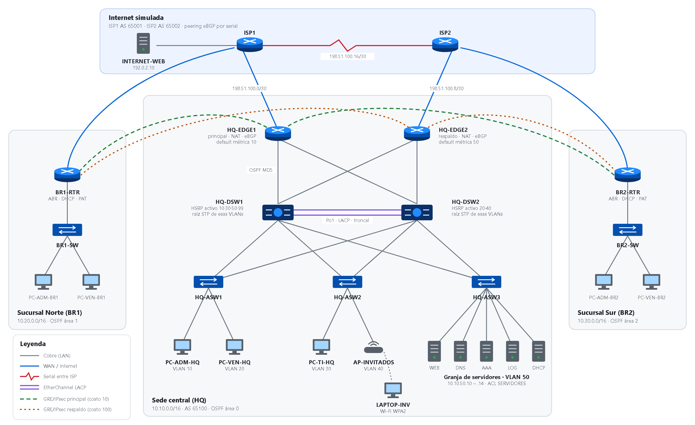

</div>

---

## 📌 Resumen

**NetCorp** es una empresa ficticia con una sede central, dos sucursales y dos proveedores de Internet. Este repositorio contiene el diseño completo de su red, las configuraciones de los 13 equipos Cisco, la topología montada en Packet Tracer y las capturas de cada prueba.

Las configuraciones **no se escriben a mano**: salen de un inventario YAML, se generan con plantillas Jinja2 y una CI en GitHub Actions las valida en cada push.

> [!TIP]
> **Qué demuestra este proyecto:** diseño jerárquico de campus, alta disponibilidad en capa 2 y capa 3, enrutamiento interno (OSPF multiárea) y externo (eBGP), VPN GRE sobre IPsec entre sedes, seguridad por planos y una forma de trabajar de *red como código* con control de versiones e integración continua.

<table>
<tr>
<td align="center"><b>28</b><br>equipos</td>
<td align="center"><b>33</b><br>cables</td>
<td align="center"><b>3</b><br>sitios</td>
<td align="center"><b>8</b><br>VLANs</td>
<td align="center"><b>4</b><br>túneles VPN</td>
<td align="center"><b>3</b><br>áreas OSPF</td>
<td align="center"><b>3</b><br>sistemas autónomos</td>
<td align="center"><b>145</b><br>pruebas automáticas</td>
<td align="center"><b>49</b><br>pruebas en Packet Tracer</td>
</tr>
</table>

## 📑 Contenido

- [Topología](#topologia)
- [Arquitectura](#arquitectura)
  - [Sitios y direccionamiento](#sitios-y-direccionamiento)
  - [Alta disponibilidad](#alta-disponibilidad)
  - [Enrutamiento](#enrutamiento)
  - [VPN entre sedes](#vpn-entre-sedes)
  - [Seguridad](#seguridad)
- [Tecnologías](#tecnologias)
- [Red como código](#red-como-codigo)
- [Validación en Packet Tracer](#validacion-en-packet-tracer)
- [Empezar](#empezar)
- [Estructura del repositorio](#estructura-del-repositorio)
- [Documentación](#documentacion)
- [Preguntas frecuentes](#preguntas-frecuentes)
- [Próximos pasos](#proximos-pasos)
- [Autor y licencia](#autor-y-licencia)

---

<a id="topologia"></a>

## 🗺️ Topología

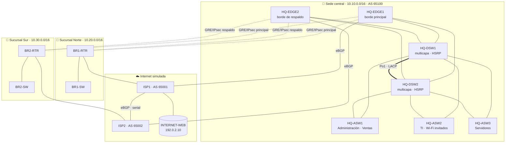

<details>
<summary><b>📋 Inventario de equipos</b></summary>

| Equipo | Modelo | Rol |
|--------|--------|-----|
| HQ-EDGE1, HQ-EDGE2 | Cisco 2911 + securityk9 | Borde: NAT, eBGP, hub de la VPN |
| HQ-DSW1, HQ-DSW2 | Cisco 3650-24PS | Núcleo colapsado y distribución: SVIs, HSRP, OSPF |
| HQ-ASW1, HQ-ASW2, HQ-ASW3 | Cisco 2960-24TT | Acceso: usuarios, Wi-Fi y servidores |
| BR1-RTR, BR2-RTR | Cisco 2911 + securityk9 | Router de sucursal: ABR, DHCP, PAT, VPN |
| BR1-SW, BR2-SW | Cisco 2960-24TT | Acceso en sucursal |
| ISP1, ISP2 | Cisco 2911 + HWIC-2T | Proveedores de Internet (AS 65001 y 65002) |
| SRV-WEB, SRV-DNS, SRV-AAA, SRV-LOG, SRV-DHCP | Server-PT | Granja de servidores (VLAN 50) |
| INTERNET-WEB | Server-PT | Sitio web y DNS "de Internet" |
| 7 PCs, LAPTOP-INV, AP-INVITADOS | PC-PT, Laptop-PT, AccessPoint-PT | Usuarios y Wi-Fi de invitados |

El cableado puerto por puerto está en [docs/generado/cableado.md](docs/generado/cableado.md).

</details>

<p align="right"><a href="#inicio">⬆️ volver arriba</a></p>

---

<a id="arquitectura"></a>

## 🏗️ Arquitectura

<a id="sitios-y-direccionamiento"></a>

### Sitios y direccionamiento

| Sitio | Bloque | VLANs | DHCP |
|-------|--------|-------|------|
| 🏢 Sede central | `10.10.0.0/16` | 10 Administración · 20 Ventas · 30 TI · 40 Invitados · 50 Servidores · 99 Gestión | SRV-DHCP con relay en los DSW |
| 🏬 Sucursal Norte | `10.20.0.0/16` | 10 Administración · 20 Ventas · 99 Gestión | Router local |
| 🏬 Sucursal Sur | `10.30.0.0/16` | 10 Administración · 20 Ventas · 99 Gestión | Router local |
| 🌍 WAN | `198.51.100.0/24` | Enlaces /30 con los ISP | — |
| 🌍 Público | `203.0.113.0/24` | Bloque propio anunciado por BGP | — |
| 🔐 Túneles | `172.16.0.0/16` | Un /30 por túnel GRE | — |

<details>
<summary><b>VLANs de la sede con gateway y HSRP</b></summary>

| VLAN | Nombre | Red | Gateway (VIP) | HSRP activo |
|------|--------|-----|---------------|-------------|
| 10 | ADMINISTRACION | `10.10.10.0/24` | 10.10.10.1 | HQ-DSW1 |
| 20 | VENTAS | `10.10.20.0/24` | 10.10.20.1 | HQ-DSW2 |
| 30 | TI | `10.10.30.0/24` | 10.10.30.1 | HQ-DSW1 |
| 40 | INVITADOS | `10.10.40.0/24` | 10.10.40.1 | HQ-DSW2 |
| 50 | SERVIDORES | `10.10.50.0/24` | 10.10.50.1 | HQ-DSW1 |
| 99 | GESTION | `10.10.99.0/24` | 10.10.99.1 | HQ-DSW1 |
| 998 | NATIVA | — | — | VLAN nativa de las troncales, sin tráfico |
| 999 | SIN-USO | — | — | Puertos apagados |

Plan completo en [docs/02-direccionamiento.md](docs/02-direccionamiento.md) y [docs/generado/direccionamiento.md](docs/generado/direccionamiento.md).

</details>

<a id="alta-disponibilidad"></a>

### Alta disponibilidad

Ningún fallo de un solo equipo de la sede deja a los usuarios sin red:

- **Núcleo colapsado redundante:** HQ-DSW1 y HQ-DSW2, unidos por un EtherChannel LACP de dos enlaces.
- **Doble troncal:** cada switch de acceso sube a los dos DSW; Rapid PVST+ bloquea una y la abre si la otra cae.
- **HSRPv2 con balanceo:** las VLANs se reparten entre los dos DSW, y la raíz de STP coincide con el HSRP activo para que el tráfico no cruce el EtherChannel.
- **Doble borde y doble ISP:** HQ-EDGE1 sale por ISP1 y HQ-EDGE2 por ISP2.
- **Doble túnel por sucursal:** uno principal hacia HQ-EDGE1 y uno de respaldo hacia HQ-EDGE2.

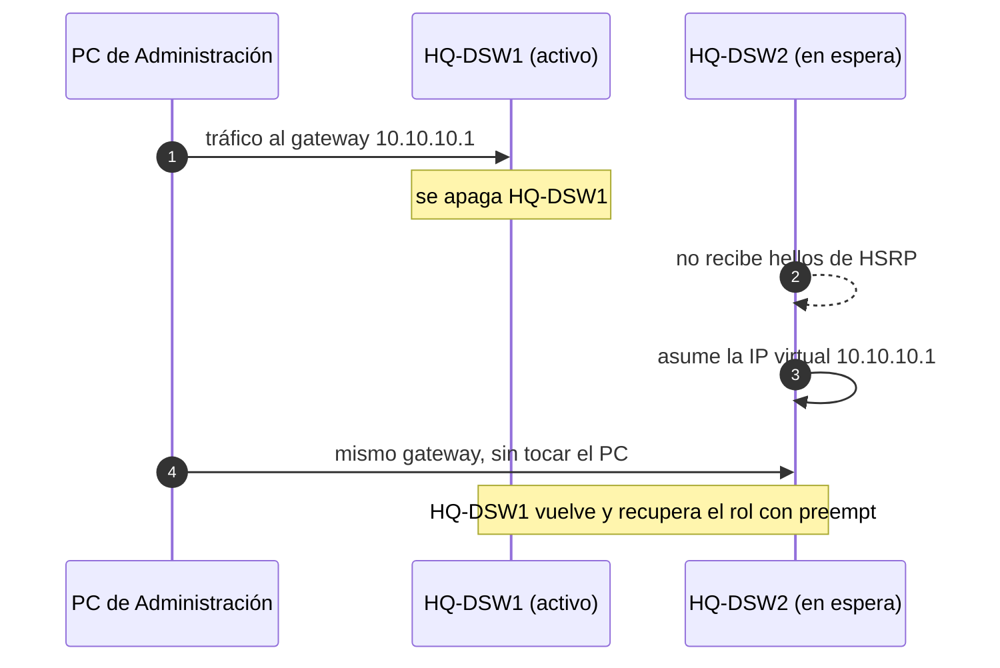

| Falla | Reacción | Tiempo |
|-------|----------|--------|
| Cae un enlace del EtherChannel | LACP sigue con el otro miembro | Inmediato |
| Cae una troncal de acceso | RSTP abre la troncal al otro DSW | 1-3 s |
| Se apaga HQ-DSW1 | HQ-DSW2 asume todas las IP virtuales | ~10 s |
| Cae HQ-EDGE1 o su enlace con ISP1 | Internet por ISP2 y sucursales por los túneles de respaldo | ~20-40 s |

<a id="enrutamiento"></a>

### Enrutamiento

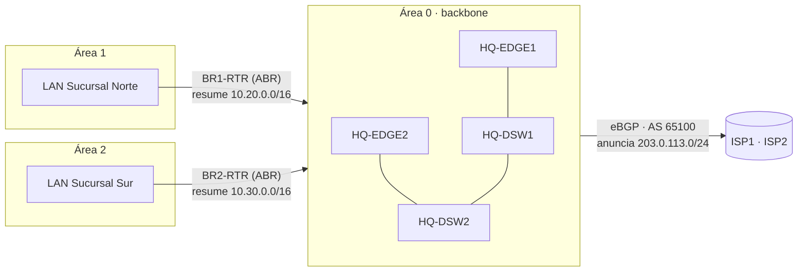

- **OSPF multiárea:** área 0 en la sede y los túneles; áreas 1 y 2 en las sucursales. Cada ABR resume su sucursal en un /16.
- **Autenticación MD5** en todo el área 0 y `passive-interface default` en los DSW.
- **eBGP** con los dos ISP: AS 65100 anuncia `203.0.113.0/24` y publica SRV-WEB con NAT estática en `203.0.113.10`.
- **Ruta por defecto** inyectada en OSPF por los dos bordes, con preferencia por HQ-EDGE1.

<a id="vpn-entre-sedes"></a>

### VPN entre sedes

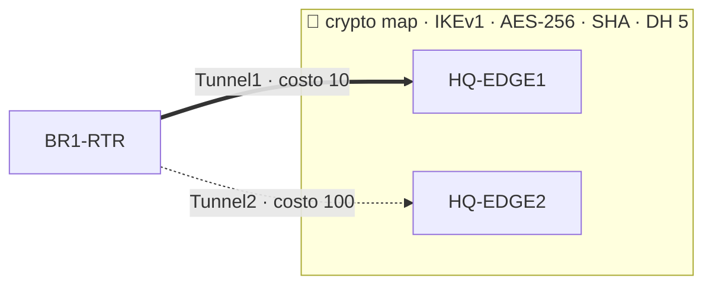

IPsec por sí solo no transporta el multicast de OSPF, así que cada sucursal usa **GRE sobre IPsec**: el túnel GRE lleva OSPF y el tráfico de usuarios, y la crypto map cifra todo el GRE entre las IP públicas. La topología es una estrella con **dos hubs**. Las sucursales salen a Internet directamente por su ISP con PAT, y solo el tráfico hacia la sede entra en la VPN.

<a id="seguridad"></a>

### Seguridad

| Plano | Controles |
|-------|-----------|
| 🛠️ **Gestión** | SSH v2 sin Telnet · SSH solo desde TI y gestión (`GESTION-SSH`) · AAA con TACACS+ y respaldo local · `login block-for` · `exec-timeout` · banner legal |
| 🧭 **Control** | MD5 en OSPF · `passive-interface default` · raíz de STP fija · BPDU Guard · troncales sin DTP · VLAN nativa sin uso |
| 📦 **Datos** | Port-security · DHCP snooping · ACL `INVITADOS` y `SERVIDORES` · puertos sin uso apagados · VPN AES-256 · NAT |

Detalle por control en [docs/04-seguridad.md](docs/04-seguridad.md).

<p align="right"><a href="#inicio">⬆️ volver arriba</a></p>

---

<a id="tecnologias"></a>

## 🧰 Tecnologías

| Área | Qué se usa |
|------|------------|
| **Conmutación** | VLANs por departamento, troncales 802.1Q con VLAN nativa sin uso, Rapid PVST+, EtherChannel LACP, VTP transparente |
| **Alta disponibilidad** | HSRPv2 con balanceo, raíz de STP alineada con HSRP, doble borde, doble ISP, túneles de respaldo |
| **Enrutamiento interno** | OSPF multiárea, resumen en los ABR, MD5, `passive-interface default` |
| **Enrutamiento externo** | eBGP con dos proveedores, bloque público propio, ruta por defecto principal y de respaldo |
| **VPN** | GRE sobre IPsec (IKEv1, AES-256, SHA, DH grupo 5) en estrella con doble hub |
| **Servicios** | NAT/PAT, NAT estática, DHCP centralizado con relay, DHCP local en sucursales, DNS, NTP, Syslog, TFTP, SNMP, AAA (TACACS+), Wi-Fi WPA2-PSK |
| **Automatización** | Inventario YAML, plantillas Jinja2, generador en Python, 145 pruebas con pytest, CI en GitHub Actions |

---

<a id="red-como-codigo"></a>

## ⚙️ Red como código

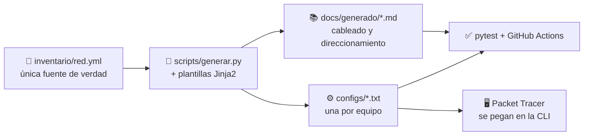

Cambiar la red es cambiar el inventario. El generador reescribe las configuraciones y la documentación, y la CI falla si alguien edita una configuración a mano o deja la documentación desactualizada (`generar.py --check`).

<details>
<summary><b>🧪 Qué revisan las 145 pruebas</b></summary>

- Que no haya IP repetidas ni VLANs que se solapen.
- Que los dos extremos de cada cable estén en la misma subred.
- Que cada túnel tenga su pareja con el mismo costo OSPF y apunte a la WAN correcta.
- Que la raíz de STP coincida con el HSRP activo.
- Que todos los equipos cumplan la línea base de seguridad: SSH v2, sin Telnet, AAA, ACL de gestión, banner...
- Que las configuraciones y la documentación generadas estén al día con el inventario.

</details>

<p align="right"><a href="#inicio">⬆️ volver arriba</a></p>

---

<a id="validacion-en-packet-tracer"></a>

## 🧪 Validación en Packet Tracer

La red está montada en [`topologia/NetCorp.pkt`](topologia/NetCorp.pkt) (Packet Tracer 9.0), con los servidores configurados y las configuraciones de `configs/` aplicadas. Sobre ella se ejecutó el [plan de pruebas](docs/05-pruebas.md) completo, y cada prueba tiene su captura en [`evidencias/`](evidencias/).

| Bloque | ✅ | ⚠️ | ❌ |
|--------|:--:|:--:|:--:|
| Capa 2 (L2-01 a L2-08) | 8 | — | — |
| HSRP y DHCP (HA-01 a HA-05) | 5 | — | — |
| Enrutamiento (RT-01 a RT-07) | 5 | 2 | — |
| VPN (VPN-01 a VPN-05) | 5 | — | — |
| Servicios y NAT (SV-01 a SV-07) | 5 | — | 2 |
| Seguridad (SEC-01 a SEC-09) | 6 | 1 | 2 |
| Pruebas de fallo (FO-01 a FO-08) | 7 | 1 | — |
| **Total (49)** | **41** | **4** | **4** |

> [!NOTE]
> Los ⚠️ y ❌ vienen de comandos que Packet Tracer acepta pero no aplica: costos OSPF en túneles, `metric` en `default-information originate` y ACL en SVIs del 3650. En IOS real funcionan. El detalle prueba por prueba está en [Limitaciones de Packet Tracer 9.0](docs/06-solucion-de-problemas.md#limitaciones-de-packet-tracer-90) y el índice de capturas en [evidencias/README.md](evidencias/README.md).

### 📸 Galería

| | |
|---|---|
| **L2-03** · EtherChannel LACP `Po1(SU)` | **HA-01** · HSRP activo en HQ-DSW1 |
| 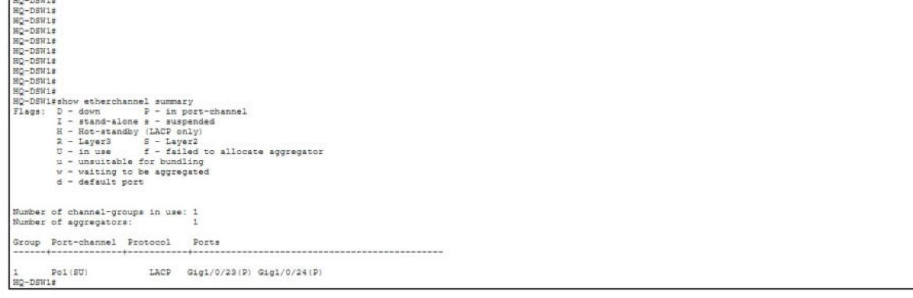 | 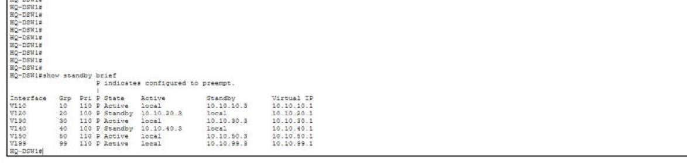 |
| **RT-03** · Rutas resumidas de las sucursales | **RT-07** · Bloque público anunciado por BGP |
| 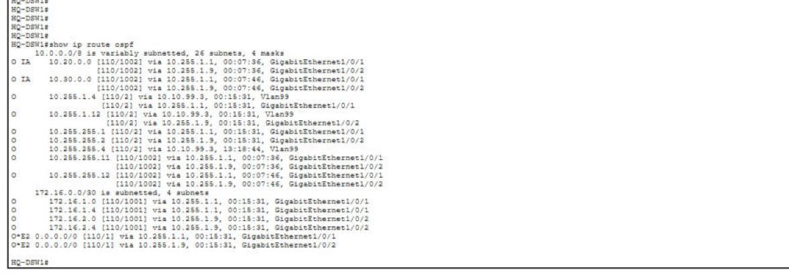 | 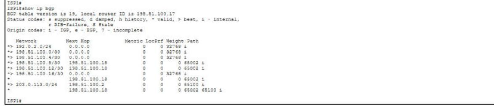 |
| **VPN-01** · IKE en `QM_IDLE` hacia las dos sucursales | **VPN-05** · De la sucursal a la sede por el túnel principal |
| 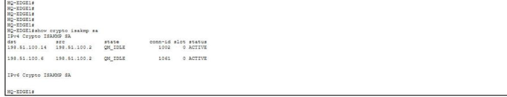 | 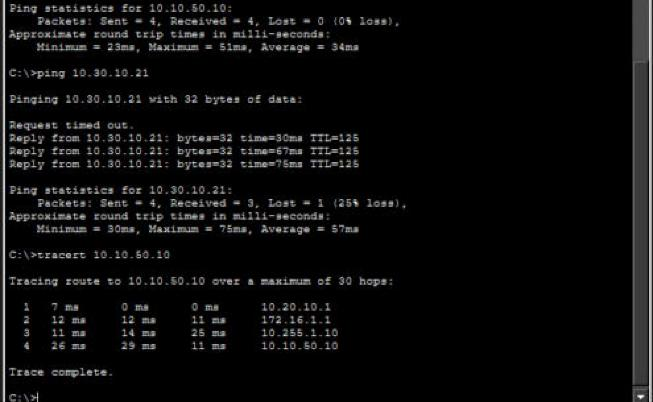 |
| **SV-01** · DNS interno y servidor web | **SV-06** · Syslog centralizado |
| 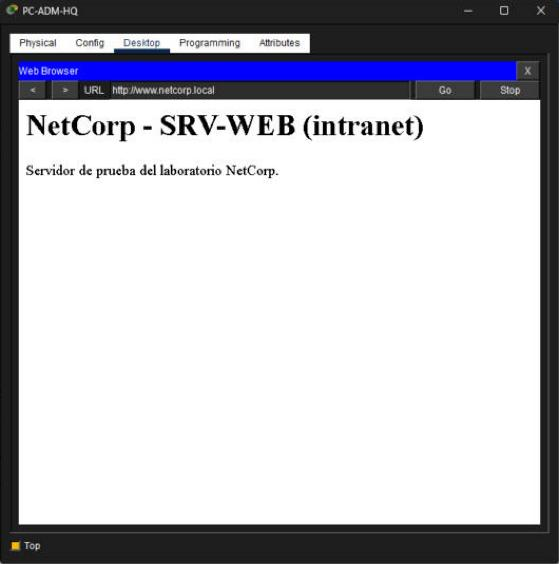 | 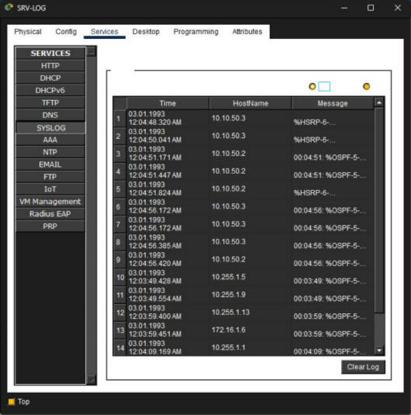 |
| **SEC-01** · SSH desde TI autenticado por TACACS+ | **SEC-08** · BPDU Guard deja el puerto en `err-disabled` |
| 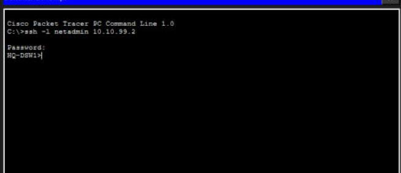 | 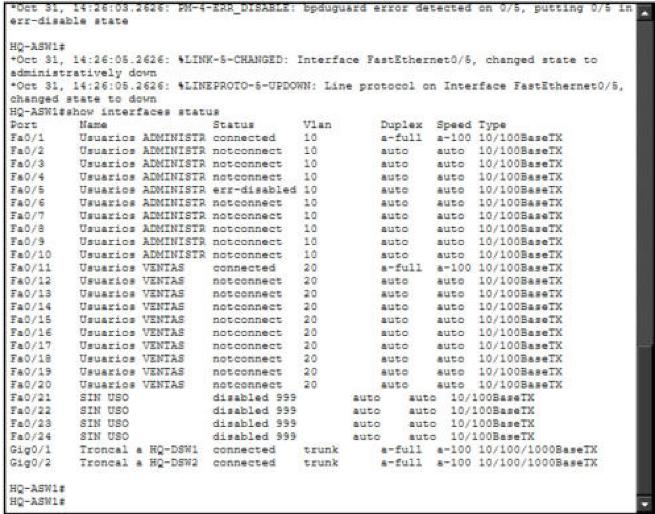 |
| **FO-03** · HQ-DSW2 asume todos los grupos HSRP | **FO-06** · La sucursal pasa al túnel de respaldo |
| 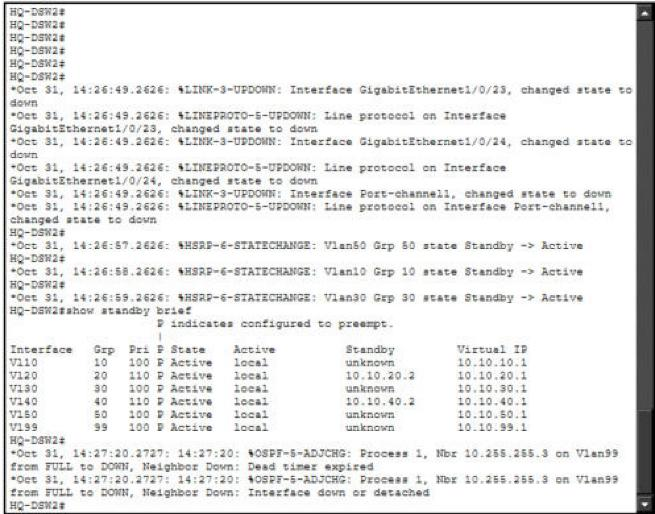 | 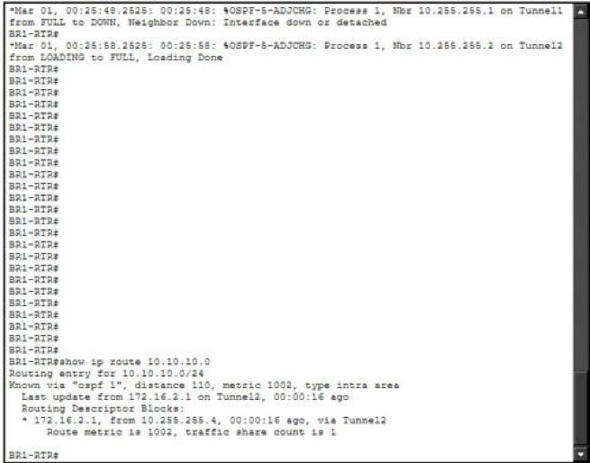 |

<p align="right"><a href="#inicio">⬆️ volver arriba</a></p>

---

<a id="empezar"></a>

## 🚀 Empezar

### Generar y validar las configuraciones

```bash
git clone https://github.com/0scar07/netcorp-cisco.git
cd netcorp-cisco
pip install -r requirements.txt
python scripts/generar.py          # regenera configs/ y docs/generado/
python scripts/generar.py --check  # falla si algo está desactualizado (lo usa la CI)
python -m pytest                   # 145 pruebas de diseño y seguridad
```

### Abrir la red ya montada

1. Abre [`topologia/NetCorp.pkt`](topologia/NetCorp.pkt) con **Packet Tracer 9.0** o posterior.
2. Espera a que los equipos terminen de arrancar.
3. En **HQ-EDGE1, HQ-EDGE2, BR1-RTR y BR2-RTR** ejecuta `copy startup-config running-config`.

> [!IMPORTANT]
> Packet Tracer lee la `startup-config` antes de activar la licencia `securityk9` y descarta los comandos `crypto`. Sin el paso 3 las VPN no levantan. Más pasos en [Al abrir `topologia/NetCorp.pkt`](docs/06-solucion-de-problemas.md#al-abrir-topologianetcorppkt).

### Montarla desde cero

Sigue [docs/03-construccion.md](docs/03-construccion.md): qué equipos poner, qué módulos agregar, cómo activar las licencias, cómo configurar los servidores y en qué orden pegar cada archivo de `configs/`.

### Credenciales de laboratorio

| Uso | Usuario | Dónde está la clave |
|-----|---------|---------------------|
| SSH y consola (TACACS+ o local) | `netadmin` | `credenciales.clave_usuario` en [inventario/red.yml](inventario/red.yml) |
| Modo privilegiado | — | `credenciales.enable_secret` |
| Wi-Fi `NetCorp-Invitados` | — | [docs/03-construccion.md](docs/03-construccion.md#paso-7--equipos-finales) |

> [!WARNING]
> Las claves del inventario son **solo de laboratorio** y están a la vista para que cualquiera pueda reproducir la red. Si reutilizas estas plantillas fuera de Packet Tracer, cámbialas y sácalas del repositorio.

<p align="right"><a href="#inicio">⬆️ volver arriba</a></p>

---

<a id="estructura-del-repositorio"></a>

## 📁 Estructura del repositorio

```
netcorp-cisco/
├── inventario/red.yml          # todo el diseño: sitios, VLANs, IPs, equipos y cables
├── plantillas/                 # plantillas Jinja2 por rol (borde, distribución, acceso, sucursal, ISP)
├── scripts/generar.py          # genera configs/ y docs/generado/
├── configs/                    # configuración final de cada equipo, lista para pegar
├── tests/                      # pruebas del diseño y de las configuraciones
├── diagramas/                  # diagrama de topología (SVG en HTML y PNG)
├── docs/
│   ├── 01-diseno.md            # requisitos, decisiones y alta disponibilidad
│   ├── 02-direccionamiento.md  # cómo está pensado el plan de IPs
│   ├── 03-construccion.md      # paso a paso para montarla en Packet Tracer
│   ├── 04-seguridad.md         # controles por plano
│   ├── 05-pruebas.md           # plan de pruebas y de fallos, con resultados
│   ├── 06-solucion-de-problemas.md
│   └── generado/               # cableado y direccionamiento (no editar a mano)
├── topologia/NetCorp.pkt       # la red montada en Packet Tracer 9.0
├── evidencias/                 # una captura por prueba (L2-01.png ... FO-08.png)
└── .github/workflows/          # CI: generar --check + pytest
```

---

<a id="documentacion"></a>

## 📚 Documentación

| # | Documento | Qué cuenta |
|---|-----------|------------|
| 1 | [Diseño y decisiones](docs/01-diseno.md) | Requisitos, arquitectura y por qué de cada decisión |
| 2 | [Plan de direccionamiento](docs/02-direccionamiento.md) · [tablas](docs/generado/direccionamiento.md) | Bloques, VLANs e IPs de cada interfaz |
| 3 | [Construcción en Packet Tracer](docs/03-construccion.md) · [cableado](docs/generado/cableado.md) | Paso a paso para montar la red |
| 4 | [Seguridad](docs/04-seguridad.md) | Controles por plano de gestión, control y datos |
| 5 | [Plan de pruebas y fallos](docs/05-pruebas.md) | 49 pruebas con su resultado y su captura |
| 6 | [Solución de problemas](docs/06-solucion-de-problemas.md) | Síntomas frecuentes y limitaciones de Packet Tracer |

---

<a id="preguntas-frecuentes"></a>

## ❓ Preguntas frecuentes

<details>
<summary><b>¿Por qué GRE sobre IPsec y no solo IPsec?</b></summary>

Una crypto map por sí sola no transporta multicast, y OSPF usa multicast para sus hellos. El túnel GRE lleva OSPF entre sedes y la crypto map cifra todo el GRE.

</details>

<details>
<summary><b>¿Por qué la raíz de STP coincide con el HSRP activo?</b></summary>

Si la raíz de una VLAN estuviera en un DSW y el gateway activo en el otro, cada paquete cruzaría el EtherChannel. Al alinearlos, el tráfico va directo del acceso al gateway. Hay una prueba automática que lo comprueba.

</details>

<details>
<summary><b>¿Por qué no hay capa de núcleo separada?</b></summary>

Con siete switches en la sede, un núcleo colapsado (distribución y núcleo en los mismos dos equipos) da la misma redundancia con menos equipos. Es el diseño que Cisco recomienda para campus de este tamaño.

</details>

<details>
<summary><b>¿Qué pasa si se cae ISP1 por completo?</b></summary>

La sede sigue por ISP2. La Sucursal Norte queda aislada, porque solo tiene ISP1. Es un punto único de fallo conocido; está en los [próximos pasos](#proximos-pasos).

</details>

<details>
<summary><b>¿Puedo editar una configuración en <code>configs/</code> directamente?</b></summary>

No. La CI falla si una configuración no coincide con lo que genera el inventario. Cambia `inventario/red.yml` (o la plantilla) y ejecuta `python scripts/generar.py`.

</details>

<details>
<summary><b>¿Por qué algunas pruebas no cumplen en Packet Tracer?</b></summary>

Porque Packet Tracer acepta algunos comandos sin aplicarlos: costos OSPF en túneles, `metric` en `default-information originate` y ACL en SVIs del 3650. Están explicados en [Limitaciones de Packet Tracer 9.0](docs/06-solucion-de-problemas.md#limitaciones-de-packet-tracer-90).

</details>

---

<a id="proximos-pasos"></a>

## 🛣️ Próximos pasos

- [x] Inventario, plantillas y generador de configuraciones
- [x] CI con 145 pruebas de diseño y seguridad
- [x] Red montada en Packet Tracer 9.0 con evidencias de las 49 pruebas
- [ ] Variante compatible con Packet Tracer de la preferencia entre bordes y túneles (costos OSPF en las interfaces físicas)
- [ ] IPv6 de doble pila con OSPFv3
- [ ] ACL de entrada en las WAN (solo IKE, ESP, BGP y tráfico de vuelta)
- [ ] SNMPv3 en lugar de SNMPv2c
- [ ] Seguimiento de enlaces en HSRP (`standby track`) cuando el simulador lo permita
- [ ] Segundo enlace a Internet en cada sucursal para eliminar su punto único de fallo
- [ ] Llevar la misma automatización a equipos reales o a Cisco CML con Netmiko o Ansible

---

<a id="autor-y-licencia"></a>

## 👤 Autor y licencia

<div align="center">

**Oscar** · [GitHub @0scar07](https://github.com/0scar07)

Proyecto publicado con [licencia MIT](LICENSE).

Si te sirvió, deja una ⭐ en el repositorio.

<a href="#inicio">⬆️ volver arriba</a>

</div>
